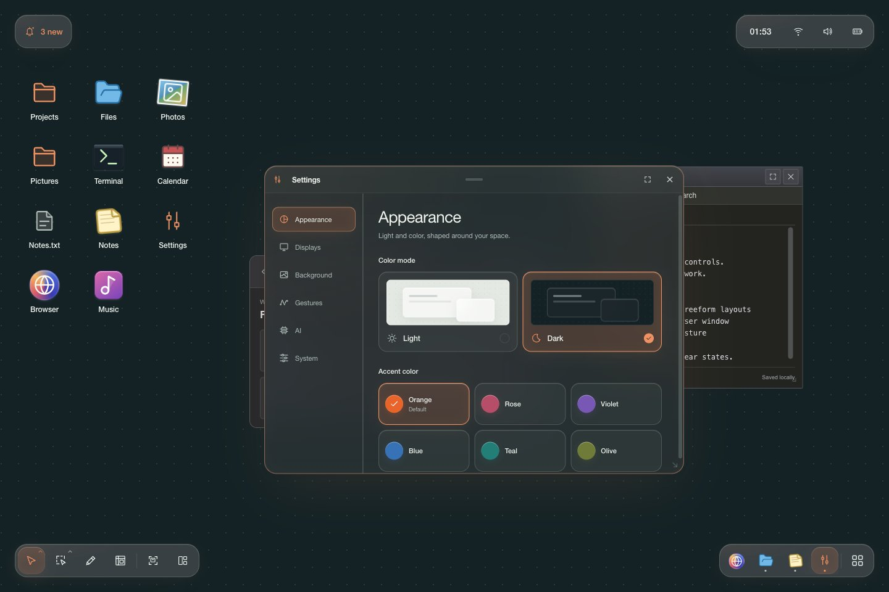

# Hearthspace UI experiments

A private browser playground for trying desktop ideas for [Hearthspace](https://github.com/crutchcorn/hearthspace), a Linux distribution exploring how computing could work. Spread windows, files, and drawings across a large canvas, attach things you want nearby to its frame, and use search to bring work into view without losing its place.



Think of it as a [painting canvas inside a frame](docs/canvas-and-frame.md). Work can move with the painting or stay attached to its edges. The default arrangement puts compact controls in four corners, with warm glass around opaque app content. We've repeatedly removed labels, counts, and instructions that only describe what's already visible. The selected window's name in the switcher helps you choose; a permanent “Drag to explore” caption doesn't need to occupy your desktop.

The [feature guide](docs/features.md) links to individual pages explaining what you can try, how each feature behaves, and what is simulated. The [visual language](docs/visual-language.md) explains the decisions behind the current design.

## Run it

Use Node.js 24 or newer and the pnpm version declared in [package.json](package.json):

```sh
pnpm install
pnpm dev
```

Open the address printed in the terminal. Browser full-screen mode gives the experiment more room. Successful GitHub Pages deployments publish to the [playground preview](https://crutchcorn.github.io/hearthspace-ui-experiments/).

## Find your way around

Each corner starts with a job, leaving the middle for your work:

| Corner       | What belongs there                                                                                          |
| ------------ | ----------------------------------------------------------------------------------------------------------- |
| Top left     | Notifications and unread status.                                                                            |
| Top right    | Clock, Wi-Fi, sound, and battery.                                                                           |
| Bottom left  | Desktop selection, panning, canvas search, window selection, drawing, Change layout, Overview, and Arrange. |
| Bottom right | Favorite and running apps, window pickers, and the app launcher.                                            |

On mobile, the default corners join into a top bar and a bottom bar. Notifications keep their space; tray icons and the right-aligned app row can scroll horizontally. Canvas tools become one selector with a flat list of choices. Change layout lets you move those controls to another edge or onto the canvas.

A few things to try:

- **Move around.** Scroll with a trackpad, hold Space and drag, or select Pan with H. Open Overview with M and drag the map to travel farther.
- **Arrange a workspace.** Drag window title bars and resize their edges. Select desktop icons and canvas controls with V, or windows with rectangle selection (R) or freeform lasso (L). Drag any selected window's title bar to move a group. Arrange (A) places unpinned windows into a grid, including those offscreen.
- **Change the layout.** Choose Change layout, then drag a window, desktop item, or control to a frame edge. Animated corner targets help align attachments with the screen boundary. Drag an attachment away from the edge to put it on the canvas, or continue to another edge to attach it there. Canvas and Background in the small editor choose a layer; Frame attaches to the nearest edge. Remove takes a personal item off the frame without deleting it; removed default controls remain searchable. Done finishes arranging.
- **Build your own frame groups.** In Change layout, place icons, controls, or windows together on the frame; overlapping attachments automatically join one group. Combine Apps, Canvas tools, and device controls into a taskbar, or keep reference windows alongside a folder. Windows keep their contents. The group's grip moves everything; selecting a member lets you move or separate it. Clock, Wi-Fi, sound, battery, and notifications can each show details or shrink to one icon.
- **Move controls with your work.** Once a control lives on the canvas, the desktop cursor can select and drag it alongside icons. Shift adds to the selection, and Alt aligns a move with the dots. A click without dragging still opens the control. Covered controls peek out and return when their original space clears, just like desktop icons.
- **Keep a window nearby.** A window pinned to the frame leaves a small strip visible. Hover reveals a little more; click to open it fully and keep it focused. Moving focus away slides it back. Closing it asks whether to close and remove it from the frame. Pinned desktop shortcuts shrink into compact glass tiles.
- **Draw on the canvas.** Choose the pencil or press D. Add strokes, then press the floating check to finish. Use the cursor (V) to select and drag the ink; its side controls open Change layout or delete it. New drawings use **Pin to top**, keeping ink at any screen position above windows and below frame controls. Dragging it into the middle keeps it pinned; **Background** puts it on the painting beneath the other canvas work. These are the drawing's only two placements. Drawings never join frame groups. With saved gestures, Play tries to launch a matching app over the drawing, consuming the ink on success.
- **Search the canvas.** Choose Search in the cursor dropdown and click the background, or press / or Ctrl/⌘ K. Windows move aside for a search field. Typing brings matching shortcuts, files, folders, windows, drawings, controls, and canvas tools into one arrangement. Up/Down changes the selection; Enter or a click opens it. Status results show their current state and open at their placed control; the canvas scrolls to controls placed offscreen. Removed controls return on the canvas. Tools select their mode or run their action; Apps opens the launcher. Escape restores the layout. Every app has a movable, permanent shortcut; the search field's pencil also accepts handwritten queries.
- **Give an app your attention.** Double-click its header to enlarge it with room for the corner controls. The maximize button fills the viewport and hides those controls; approaching any corner reveals them together. Switching to another window returns you to the movable canvas.
- **Switch windows.** Hold Ctrl and press 1 to bring the open windows into a temporary grid. Press 1 again to cycle forward, or add Shift to go backward. Release Ctrl to restore the layout, focus the chosen window, and center it on the canvas. Escape cancels and restores the previous view. This shortcut depends on the browser delivering it to the page.
- **Open something.** Choose Apps to browse, search, or switch between icon and list views. Drag an app shortcut onto Apps to add it to favorites; its original shortcut returns to the canvas. Running apps show window dots and open a picker for their instances. The launcher's Draw view offers a dedicated gesture pad.

## Make it yours

Open Settings from Apps. Appearance offers Light/Dark mode and six accents, with Orange as the default. Background accepts a photo that either repeats with the canvas or stays fixed using Stretch, Contain, or Cover. System opens **Change layout** for frame placement, grouping, and status detail, including the battery percentage. App icons and frames always retain the visual variety we expect from Linux applications; the shared shell keeps them feeling at home together.

Gestures lets you add, edit, and remove app assignments using a searchable app picker and drawing pad. Displays lets you drag two monitor previews, snap their edges together, and try per-monitor settings. AI presents opt-in controls for gathering related windows, including a simulated model download and a confirmation before turning it off.

Canvas tools are protected from removal until you enable **Make canvas tools hide-able** in System settings. An attempted removal explains how to recover them. Search remains available through / or Ctrl/⌘ K, and System settings has a **Restore canvas tools** button.

Window and desktop-item positions, canvas drawings, frame attachments and groups, status detail, favorites, canvas layers, scratchpad text, gesture assignments, and preferences are saved in this browser when storage is available. Notifications and mock display settings reset on reload.

The current scene format starts a fresh desktop instead of importing layouts saved by earlier versions of this playground. Appearance, backgrounds, favorites, gestures, and other preferences keep their separate saved values.

This remains an interaction experiment. App windows are previews, device controls don't change your computer, and drawn launch gestures match the shortcuts saved in Settings. AI gathering starts off and performs no model download or analysis. After opt-in, Gather similar windows uses a same-app rule: following a brief shimmer, other windows from the selected applications move into view.

Handwriting search separately downloads about 64 MB of model weights plus its runtime on first use, then reads ink locally; recognition can make mistakes. The [feature guide](docs/features.md) keeps these boundaries alongside the relevant controls.

For contributor commands, see [CONTRIBUTING.md](CONTRIBUTING.md). For implementation details, start with the [technical documentation](docs/README.md).
